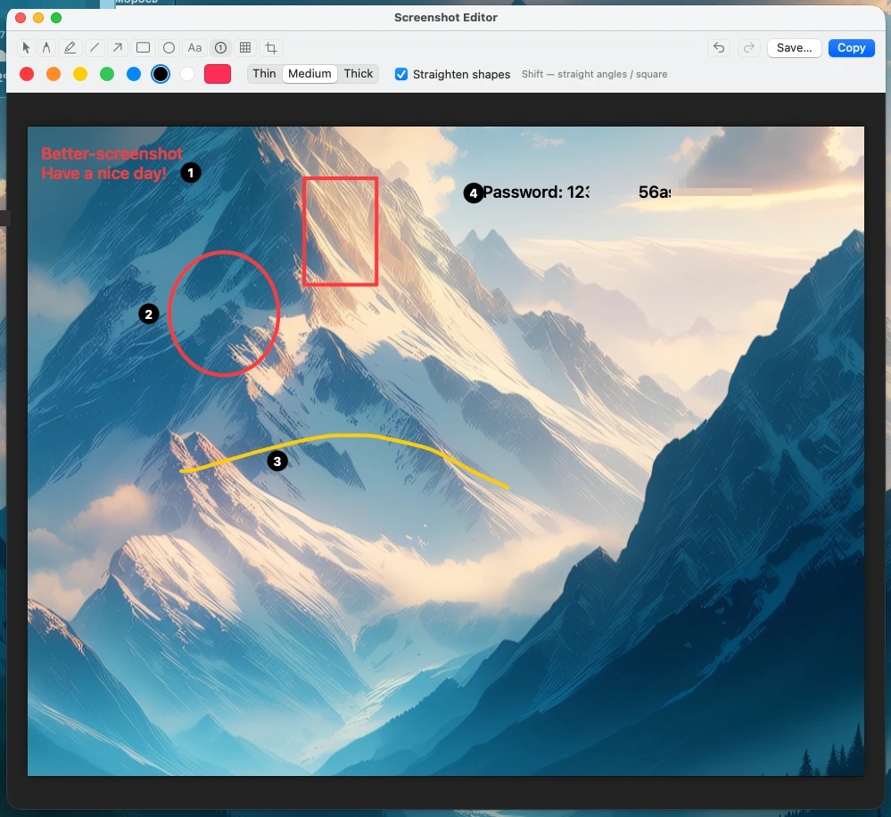
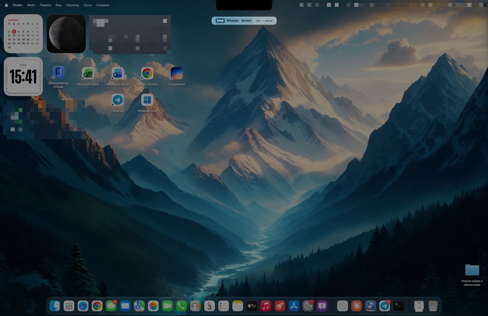
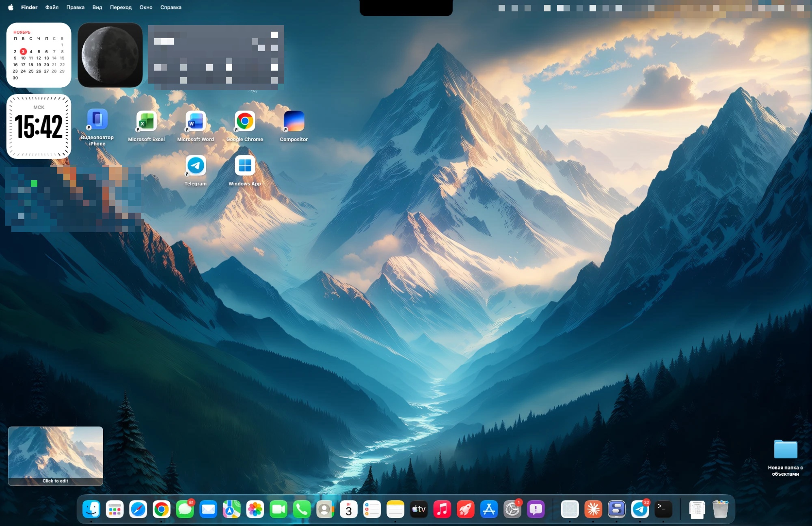
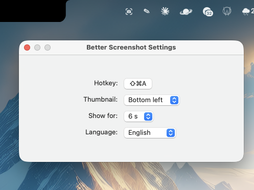

# Better Screenshot

Convenient screenshots for macOS, the way Windows does it: pick an area / window / screen, get a thumbnail in the corner and a simple editor; also screen recording and text recognition. Free and open source.

**English** | [Русский](#русская-версия)



| | |
|---|---|
|  |  |
|  | |

## Features

- Global hotkey (default **⇧⌘S**, configurable in Settings).
- Capture modes: **area**, **window**, **full screen** (keys 1 / 2 / 3, Esc to cancel).
- The screenshot goes to the clipboard immediately; a thumbnail appears in a screen corner (corner and duration are configurable). Click it to open the editor.
- Editor: pencil, highlighter, line, arrow, rectangle, oval, **text** (⌥/⌘/⇧ + Enter for a new line, double-click to edit), step numbers, **mosaic** (hide passwords and other secrets) and crop.
- **Shape straightening**: a hand-drawn circle, rectangle, line or arrow becomes a clean one. ⌘Z brings back exactly what you drew.
- Hold **Shift** while drawing for straight lines (15° steps) and squares / circles.
- **Copy** (to the clipboard, closes the editor) and **Save…** (PNG) buttons.
- **Text recognition (OCR)**: switch the picker to **Text** (or press **T**), choose an area, window or screen, and the text in it goes to the clipboard. Works on-device (Apple Vision) with no internet; supports English, Russian, Ukrainian, German, French, Spanish, Chinese and Japanese. QR codes and bar codes are decoded too.
- **Screen recording**: switch **Screenshot | Record** in the same picker (or press **R**), choose the area, and recording starts. A floating panel shows the timer and lets you toggle the **microphone** and **system sound** at any time; the same hotkey stops the recording. The MP4 is saved to `~/Movies/Better Screenshot/` and copied to the clipboard; click the thumbnail to preview it, reveal it in Finder or export a **GIF**.
- **Opens images from [Better Clipboard](https://github.com/chop0r/better-clipboard)** (free clipboard history): edit any old screenshot from your history in this editor. Also available via *Open With* for PNG / JPEG / TIFF files, and from the menu: **Edit image from clipboard**.
- **About** window in the menu with links to this repository and the author.
- **Launch at login** (on by default after the first run, can be turned off in Settings).
- **Languages**: English (default), Русский, Українська, Deutsch, Français, Español, 简体中文, 日本語 — pick one in Settings. Translations were made with AI; corrections are welcome.

## Install

1. Download `Better-Screenshot-*.dmg` from [Releases](../../releases) and drag the app into Applications. Requires macOS 15 or newer; runs on Apple Silicon and Intel.
2. The app is not signed with an Apple Developer certificate, so on first launch: right-click → **Open**. If macOS says the app is damaged:
   ```bash
   xattr -dr com.apple.quarantine "/Applications/Better Screenshot.app"
   ```
3. Allow it in System Settings → Privacy & Security → **Screen Recording** (and **Microphone** if you record your voice), then restart the app.

The app lives in the menu bar (camera icon) and has no Dock icon.

## Build from source

Needs Swift 5.9+ (Command Line Tools are enough).

```bash
./build.sh              # builds "Better Screenshot.app"
./package.sh 0.1.0      # universal .dmg installer in dist/
```

## Support the author

The app is free. If it is useful to you and you want to say thanks: [DonationAlerts](https://www.donationalerts.com/r/chopor). Thank you!

## Made with AI

This project was created with the help of an AI assistant (Claude by Anthropic) under the author's direction. As with any software, read the code and test it before relying on it.

## License

[MIT](LICENSE) — use it freely.

---

<a id="русская-версия"></a>

# Русская версия

[↑ English](#better-screenshot)


Удобные скриншоты для macOS, как в Windows: выбор области / окна / экрана, миниатюра в углу и простой редактор. Бесплатно и с открытым кодом.

## Возможности

- Глобальная горячая клавиша (по умолчанию **⇧⌘S**, меняется в настройках).
- Режимы: **область**, **окно**, **весь экран** (клавиши 1 / 2 / 3, Esc — отмена).
- Снимок сразу попадает в буфер обмена; миниатюра появляется в углу экрана (угол и время показа настраиваются). Клик по ней открывает редактор.
- Редактор: карандаш, маркер, линия, стрелка, прямоугольник, овал, **текст** (⌥/⌘/⇧ + Enter — новая строка, двойной клик — правка), нумерация шагов, **мозаика** (скрыть пароли и другие секреты) и обрезка.
- **Выпрямление фигур**: нарисованные от руки круг, прямоугольник, линия и стрелка становятся ровными. ⌘Z возвращает штрих как был нарисован.
- **Shift** при рисовании — ровные линии (шаг 15°), квадраты и круги.
- Кнопки **«Копировать»** (в буфер, редактор закрывается) и **«Сохранить…»** (PNG).
- **Распознавание текста (OCR)**: переключите выбор на **Текст** (или нажмите **T**), выберите область, окно или экран — и текст из него окажется в буфере. Работает на самом Mac (Apple Vision), без интернета; понимает английский, русский, украинский, немецкий, французский, испанский, китайский и японский. QR-коды и штрихкоды тоже читаются.
- **Запись экрана**: в том же выборе переключатель **Скриншот | Запись** (или клавиша **R**), выбираете область — и запись идёт. Плавающая панель показывает таймер и позволяет в любой момент включать и выключать **микрофон** и **звук системы**; то же сочетание останавливает запись. MP4 сохраняется в `~/Movies/Better Screenshot/` и копируется в буфер; клик по миниатюре открывает просмотр, показ в Finder и экспорт в **GIF**.
- **Открывает изображения из [Better Clipboard](https://github.com/chop0r/better-clipboard)** (бесплатная история буфера): любой старый скриншот из истории можно править в этом редакторе. Также доступно через «Открыть в программе» для файлов PNG / JPEG / TIFF и из меню: **«Править изображение из буфера»**.
- Окно **«О программе»** в меню со ссылками на репозиторий и автора.
- **Автозапуск при входе** (после первого запуска включён, выключается в настройках).
- **Языки**: English (по умолчанию), Русский, Українська, Deutsch, Français, Español, 简体中文, 日本語 — выбираются в настройках. Переводы сделаны нейросетью, исправления приветствуются.

## Установка

1. Скачайте `Better-Screenshot-*.dmg` на странице [Releases](../../releases) и перетащите приложение в «Программы». Нужна macOS 15 или новее; работает на Apple Silicon и Intel.
2. Приложение не подписано сертификатом Apple Developer, поэтому при первом запуске: правый клик → **Открыть**. Если macOS пишет, что приложение повреждено:
   ```bash
   xattr -dr com.apple.quarantine "/Applications/Better Screenshot.app"
   ```
3. Разрешите доступ в Системные настройки → Конфиденциальность и безопасность → **Запись экрана** (и **Микрофон**, если пишете голос) и перезапустите приложение.

Приложение живёт в строке меню (иконка камеры), значка в Dock нет.

## Сборка из исходников

Нужен Swift 5.9+ (хватит Command Line Tools).

```bash
./build.sh              # собирает "Better Screenshot.app"
./package.sh 0.1.0      # универсальный .dmg в dist/
```

## Поддержать автора

Приложение бесплатное. Если оно вам пригодилось и хочется сказать спасибо: [DonationAlerts](https://www.donationalerts.com/r/chopor). Спасибо!

## Создано с помощью нейросети

Проект создан с помощью нейросети (Claude от Anthropic) под руководством автора. Как и любое другое ПО, прочитайте код и проверьте его, прежде чем на него полагаться.

## Лицензия

[MIT](LICENSE) — используйте свободно.
